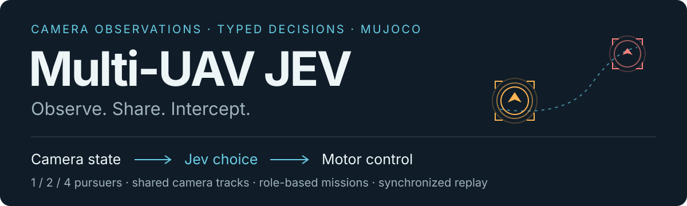
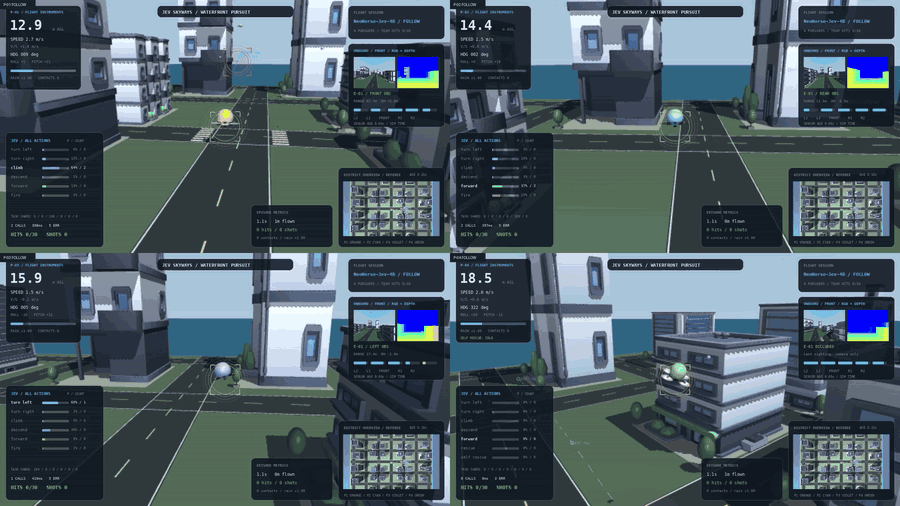
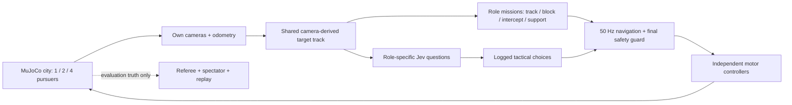

<p align="center">
  
</p>

<p align="center">
  <a href="LICENSE"></a>
  <a href="docs/quickstart.md"></a>
  <a href="https://huggingface.co/TokenRhythm/NeoHorse-Jev-4B"></a>
</p>

<p align="center"><b>English</b> · <a href="README.zh-CN.md">简体中文</a><br>
<a href="#quick-start">Quick start</a> · <a href="docs/multi-uav.md">Fleet guide</a> · <a href="docs/policy.md">Prompt &amp; actions</a> · <a href="docs/data.md">Data collection</a></p>

# Multi-UAV JEV

**Camera-observed cooperative UAV pursuit in a MuJoCo city.** Choose **1, 2 or 4 pursuers**, share onboard target observations, and inspect how tracking, forward blockade, predictive interception and support work together.

Each aircraft has its own free joint, four motors, camera perception, controller and Jev decision worker. This release implements a physical fleet with distinct missions and synchronized full-instrument replay.

<p align="center">
  
</p>

<p align="center"><em>Four independent UAVs with synchronized follow cameras: tracking, forward blockade, predictive interception and support/rescue. Full recordings preserve 20 FPS and every aircraft’s complete instruments.</em></p>

[Capture provenance and full-size still](assets/readme/fleet-captures.md) · [Fleet guide](docs/multi-uav.md).

## What you can explore

- **A fleet with complementary jobs.** P-01 maintains contact; P-02 occupies a point ahead of the target; P-03 predicts a future meeting point; P-04 provides support and rescue instead of simulated fire.
- **Shared, inspectable observations.** Fuse camera-derived positions, confidence, timestamps and velocity estimates. Shared information does not become local camera visibility. Stale observations expire into search.
- **Editable role rules.** Change [sim/role.md](sim/role.md) to tune instructions, deployment positions, mission horizons and recovery limits. Valid edits reload while running; invalid edits retain the previous configuration.
- **A complete live cockpit.** Follow every drone, click to enlarge, or focus one aircraft. RGB, depth, candidate probabilities, action counts, predicted paths, HIT/MISS effects and the district overview remain available. Landscape screens use a separate control sidebar.
- **Inspectable recordings and cases.** Record every active follow camera at 20 FPS; retain the best two qualifying episodes separately for 1 / 2 / 4 aircraft. Archive successful and failed decision/event records independently of replay selection.

## Fleet roles

| Aircraft | Mission | Behavior |
| --- | --- | --- |
| P-01 | Continuous tracking | Maintain camera contact and provide observations; another pursuer can temporarily relay tracking if P-01 is unhealthy. |
| P-02 | Forward blockade | Extrapolate current motion, compare arrival times and commit to a point ahead; hold there rather than match the target's velocity. |
| P-03 | Predictive interception | Fit velocity/turn trends from shared history and seek a reachable future meeting point; replan when the track changes. |
| P-04 | Communication support + rescue | Maintain coverage, approach a troubled teammate at safe spacing, and request motor-based recovery; recover itself first when stuck or unstable. |

One aircraft uses the original pursuit baseline; two activate P-01/P-02; four activate all roles. Late or unreachable plans are shown explicitly. [Planning, rescue and configuration details →](docs/multi-uav.md)

## How it works



**Observation boundary:** Jev receives structured **text** derived from depth, ideal MuJoCo target segmentation and own odometry. Raw RGB/depth tensors are displayed, not submitted to this release's decision model. Enemy truth coordinates, building maps and the scripted future route are excluded from navigation and model input. Referee/spectator views may use truth. [Architecture →](docs/architecture.md)

**Control ownership:** this is a hybrid system. Jev selects role-specific tactical actions; deterministic mission navigation, depth braking, peer separation and recovery continue independently at **50 Hz simulation time**. A busy or failed endpoint does not become a fabricated model decision. Navigation and safety can continue while waiting for a fresh response. Multi-agent choices older than **0.8 simulated seconds** are logged and discarded.

## Quick start

Validated on **Linux, Python 3.12, MuJoCo 3.14.0 and EGL**. Model weights and GPU inference dependencies are separate from the simulation environment.

```bash
git clone https://github.com/YongLD/Multi-UAV-JEV.git
cd Multi-UAV-JEV
bash setup.sh
```

Start a compatible NeoHorse endpoint in another terminal using [the model setup guide](docs/model-setup.md), then:

```bash
export JEV_ENDPOINT=http://127.0.0.1:8000/v1/systemone
bash run.sh --drones 4
```

Open **[http://127.0.0.1:8080](http://127.0.0.1:8080)**. Select **1 / 2 / 4** in the page; changing the count starts a new episode. Switching the focused drone or enlarging a monitor does not restart it. The runner repeats seeds and archives text cases; `Ctrl+C` stops its owned processes.

<details>
<summary><b>Run options</b></summary>

```bash
# Initial fleet: 1 / 2 / 4. Without this option, reuse the saved UI selection.
bash run.sh --drones 2
# One episode, then stop its viewer.
bash run.sh --once --drones 4 --seconds 120 --seed 42
# Collect without a browser server.
bash run.sh --no-viewer --drones 4
# Configure viewer port and output directory.
VIEW_PORT=8090 DATA_DIR=./runs-experiment bash run.sh
```

Copy `.env.example` to `.env` for persistent settings. `FLEET_COUNT` optionally sets the initial count; a blank value preserves the saved UI selection. [Complete installation and troubleshooting →](docs/quickstart.md)

</details>

## Actions and recovery

P-01/P-02/P-03 offer five flight choices—`turn_left`, `turn_right`, `climb`, `descend`, `forward`—plus virtual `fire`. P-04 replaces `fire` with `rescue` and adds **`self_rescue`**, for seven choices. Candidate meanings, selection conditions and role instructions are resolved from [role.md](sim/role.md); actual prompts are exported to the episode policy record.

Flight choices use ±45° heading or ±2 m altitude intents with controller-owned speed and 3–36 m altitude bounds. Fleet mission navigation and final safety constraints govern actual movement; this differs from the single-agent baseline's direct setpoint execution. Simulated fire requires fresh local visibility and healthy aircraft state in the fleet, followed by the virtual referee checks.

P-04 self-rescue prioritizes attitude recovery, scans when no known clear direction exists, then escapes slowly using fresh depth and peer checks. Recovery requires measured displacement and sustained stability. Attempts have a timeout and a bounded retry count; failure remains visible. There is **no teleport or pose reset** during recovery. [Exact semantics and limits →](docs/policy.md)

## Replay, outcomes and data

- An episode ends at **30 team hits**, its configured simulation-time limit (**120 s** by default), a whole-team crash, or restart.
- Virtual-hit geometry uses **3D range ≤25 m**, **horizontal bearing ≤40°**, **altitude difference ≤1 m** and a **2 s cooldown** per pursuer. Fleet execution additionally checks current camera evidence. These are simulated interactions only.
- Each fleet-size group retains its **top two completed episodes with ≥5 hits**, ranked by hits; newer ties win. Up to **six replay sets** are retained. Old clips keep their ranking until a better eligible recording replaces them.
- Full replay streams are **1280×720 per aircraft, 20 FPS**. Two-camera overview: **2560×720**; four-camera overview: **2560×1440**. Every stream shares the same capture clock; switching views keeps playback time and pause state.
- Recording takes actual states every **0.05 simulated seconds** with bounded encoder backpressure. Overload slows simulation instead of dropping frames. Live monitor images publish at **5 updates per simulated second**; that is distinct from recording FPS and wall-clock speed.
- RGB/depth refresh with perception (**0.15 s** in the fleet); overview refreshes separately (**0.3 s**). Their displayed ages are time since the last sensor capture, not aircraft age. Historical follow-only recordings cannot recover unrecorded instruments.

`runs/live/` contains frames, status, the replay catalog and immutable camera sets. `runs/cases/<timestamp>_seedN/` stores `decisions.jsonl`, `events.jsonl`, `referee.jsonl`, `policy.json` and `summary.json`. These are **raw training candidates**, not expert labels. Keep model errors, stale responses, automatic controller actions and referee truth distinct when curating data. [Data schema →](docs/data.md)

## Project layout

```text
sim/
├── fleet_sim.py           Independent physical aircraft and episode loop
├── fleet_tracking.py      Shared observation fusion and peer separation
├── fleet_missions.py      Forward blockade and predictive interception
├── fleet_control.py       Mission coordination and teammate rescue
├── fleet_self_rescue.py   Bounded motor-only support-aircraft recovery
├── fleet_roles.py         Validated, reloadable role configuration
├── role.md                Editable behavior rules and mission parameters
├── fleet_replay.py        Synchronized full-HUD camera encoding
├── replay_store.py        Two ranked replay sets per fleet size
└── urban.html             Live views, focus, replay and landscape layout
scripts/run.py             Runner, initial fleet selection and case archive
docs/                     Setup, architecture, policy, fleet and data guides
assets/readme/            Editable identity, real demonstration GIFs and stills
```

## Validation and current limits

The fleet suite covers observation fusion/expiry, independent motors, mission planning, final safety constraints, rescue/self-rescue, replay ranking, synchronized frames and seek APIs. Run:

```bash
.venv/bin/python -m compileall -q sim scripts
cd sim
../.venv/bin/python -m unittest test_fleet test_fleet_physics test_fleet_rescue test_fleet_missions test_fleet_visuals test_fleet_replay test_replay_store test_fleet_self_rescue
```

Tracking and obstacle avoidance remain experimental. Communication is currently an **ideal zero-delay broadcast** in a common odometry frame: the support role does not yet model radio range, packet loss or network relay physics. Segmentation is idealized, the evader is kinematic, finite camera coverage and conservative collision hulls can cause contacts, and model/encoder load can slow wall-clock execution. A favorable GIF or short check does not establish improved multi-agent success rates. Future work includes learned visual detection, communication impairments and aggregate evaluation across matched seeds.

## Acknowledgements and license

Built on [RomanSlack/jev-drone](https://github.com/RomanSlack/jev-drone), the [MuJoCo Menagerie Skydio X2](https://github.com/google-deepmind/mujoco_menagerie/tree/main/skydio_x2), and [Kenney City Kit Commercial](https://kenney.nl/assets/city-kit-commercial). Decisions use the external [TokenRhythm NeoHorse-Jev-4B](https://huggingface.co/TokenRhythm/NeoHorse-Jev-4B) release.

New project contributions are **Apache-2.0**; inherited jev-drone code retains **MIT** terms; bundled city meshes are **CC0**. Downloaded robot assets, model weights and inference runtimes retain their own licenses. See [LICENSE](LICENSE), [NOTICE](NOTICE) and [the inherited MIT license](licenses/jev-drone-MIT.txt).
