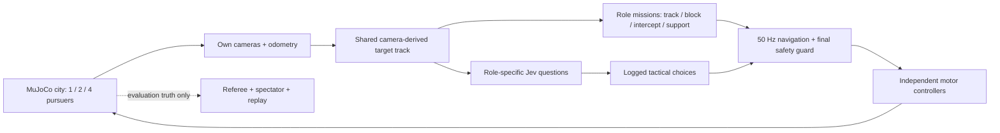

<p align="center">
  
</p>

<p align="center">
  <a href="LICENSE"></a>
  <a href="docs/quickstart.md"></a>
  <a href="https://huggingface.co/TokenRhythm/NeoHorse-Jev-4B"></a>
</p>

<p align="center"><a href="README.md">English</a> · <b>简体中文</b><br>
<a href="#快速开始">快速开始</a> · <a href="docs/multi-uav.md">多机指南</a> · <a href="docs/policy.md">Prompt 与动作</a> · <a href="docs/data.md">数据采集</a></p>

# Multi-UAV JEV

**基于机载相机观测的 MuJoCo 多无人机协同追踪平台。** 可选择 **1、2、4 架**追踪机，共享目标观测，并查看持续跟踪、前方堵截、预测拦截和保障救助如何协作。

每架无人机都有独立的自由关节、四个电机、相机感知、控制器和 Jev 决策队列。本版本已实现不同任务的物理多机仿真及同步完整仪表回放。

<p align="center">
  
</p>

<p align="center"><em>四架独立物理无人机的同步跟随视角：持续跟踪、前方堵截、预测拦截与保障救助。完整录像保留 20 FPS 以及每架机的全部仪表信息。</em></p>

[素材来源与静态预览](assets/readme/fleet-captures.md) · [多机实现指南](docs/multi-uav.md)。

## 可以查看什么

- **不同任务的协作。** P-01 持续观测；P-02 到目标前方堵截；P-03 预测未来交汇点；P-04 负责保障与救助，没有 `fire` 动作。
- **可检查的共享观测。** 融合相机测得的位置、置信度、时间与速度估计。队友看见目标不会被标为本机相机可见；观测过期后转为搜索。
- **可编辑的角色规则。** 修改 [sim/role.md](sim/role.md) 中的指令、部署位置、规划时域和恢复参数。合法规则运行时加载，解析失败沿用上一版；起飞点下一局生效。
- **完整实时驾驶舱。** 同时查看跟随画面，点击放大，或聚焦某架机。保留 RGB、深度、动作概率与次数、预测线、HIT/MISS 特效和俯视图，横屏使用独立控制侧栏。
- **同步录像与实验档案。** 全部活动相机录制 20 FPS；1 / 2 / 4 架分别保留命中最高的两局。成功、超时、坠落和手动重启的文本记录独立归档。

## 四个角色

| 无人机 | 任务 | 行为 |
| --- | --- | --- |
| P-01 | 持续跟踪 | 保持相机接触并提供观测；异常时可由其他追踪机临时接力。 |
| P-02 | 前方堵截 | 根据当前运动方向外推，比较到达时间并承诺前方站位；到位守候，不持续匹配敌机速度。 |
| P-03 | 预测拦截 | 根据历史观测拟合速度和转弯趋势，寻找可达的未来交汇点，并随新观测重规划。 |
| P-04 | 通信保障与救助 | 维持观测覆盖，保持安全距离接近异常队友，授权其通过电机恢复；自身卡住或失稳时优先自救。 |

1 架沿用单机基线；2 架启用 P-01/P-02；4 架启用全部角色。预计迟到或无法到达的规划会明确显示。[规划、救助和配置细节 →](docs/multi-uav.md)

## 工作流程与信息边界



Jev 接收由深度、MuJoCo 理想目标分割和自身里程计构成的**结构化文本**。本版本的 RGB/深度图用于展示，不作为原始图像张量提交给模型。导航与模型输入不读取敌机真值坐标、建筑地图或预设未来路线；裁判与观看视角可使用仿真真值。[架构说明](docs/architecture.md)。

这是混合控制系统：Jev 选择角色对应的战术动作；任务导航、深度制动、机间分离和恢复以 **50 Hz 仿真时间**持续更新。模型繁忙或失败会如实记录，等待新决策时导航和安全控制继续工作，不伪造模型动作。多机中超过 **0.8 秒仿真时间**的响应被记录并拒绝执行。

## 快速开始

已验证环境：**Linux、Python 3.12、MuJoCo 3.14.0、EGL**。模型权重与 GPU 推理依赖需单独安装。

```bash
git clone https://github.com/YongLD/Multi-UAV-JEV.git
cd Multi-UAV-JEV
bash setup.sh
```

按照[模型安装指南](docs/model-setup.md) 在另一终端启动兼容的 NeoHorse 服务，然后：

```bash
export JEV_ENDPOINT=http://127.0.0.1:8000/v1/systemone
bash run.sh --drones 4
```

打开 **[http://127.0.0.1:8080](http://127.0.0.1:8080)**。页面切换 **1 / 2 / 4** 会开始新一局；切换聚焦无人机或放大画面不会重开。运行器自动更换种子并保存文本档案，`Ctrl+C` 停止它拥有的进程。

<details>
<summary><b>启动选项</b></summary>

```bash
# Initial fleet: 1 / 2 / 4. Without this option, reuse the saved UI selection.
bash run.sh --drones 2
# One episode, then stop its viewer.
bash run.sh --once --drones 4 --seconds 120 --seed 42
# Collect without a browser server.
bash run.sh --no-viewer --drones 4
# Configure viewer port and output directory.
VIEW_PORT=8090 DATA_DIR=./runs-experiment bash run.sh
```

将 `.env.example` 复制为 `.env` 保存本地配置。`FLEET_COUNT` 可指定初始数量；留空则保留上次页面选择。[完整安装与排错](docs/quickstart.md)。

</details>

## 动作与自救

前三架有 `turn_left`、`turn_right`、`climb`、`descend`、`forward` 五种飞行动作及虚拟 `fire`。第四架用 `rescue` 替代 `fire`，再增加 **`self_rescue`**，共七个候选。角色 prompt、动作条件和参数统一在 [role.md](sim/role.md)，每局导出实际配置用于复核。

飞行动作表达 ±45° 航向或 ±2 m 高度意图；速度由控制器管理，高度目标限制在 3–36 m。多机实际运动由角色任务导航和最终安全约束共同控制，与单机直接执行目标值的基线有所区别。多机发射需要健康状态及新鲜本机可见目标，再由虚拟裁判判定。

四号机自救先恢复姿态，没有已知安全方向时旋转扫描，再根据新鲜深度和队友接近风险低速脱困。必须达到实际位移及持续稳定条件才判为恢复；单次超时、最多重试次数和失败状态明确可见。恢复过程中**不瞬移，不重置位置或姿态**。[动作执行细节](docs/policy.md)。

## 回放、终止条件与数据

- 默认每局上限 **120 秒仿真时间**，达到 **30 次团队命中**、全队坠落或重启可提前结束。仿真负载高时，现实等待可能更久。
- 虚拟命中几何条件为三维距离 **≤25 m**、水平偏角 **≤40°**、高度差 **≤1 m**、每机冷却 **2 s**；多机执行层另查当前相机证据。这些只用于仿真交互。
- **1 / 2 / 4 架各保留两局**：完成对局且至少 **5 次命中**才参与本组排名，同分保留较新录像，总计最多六组。旧录像保留排名，等待新完整录像按命中数入选。
- 每架机视频 **1280×720、20 FPS**；两机总览 **2560×720**，四机总览 **2560×1440**。切换回放视角保留播放进度与暂停状态。
- 每 **0.05 秒仿真时间**采集真实状态，后台编码队列满时等待，不丢帧、不靠重复旧帧补帧。实时监控图片每仿真秒发布 **5 次**，与录像帧率、现实时间运行速度是不同指标。
- RGB/深度按多机感知周期 **0.15 s**更新，俯视图按 **0.3 s**更新，面板显示实际采集信息的年龄。“距最近观测”指距离上次有效观测的仿真时间。旧纯跟随录像没有采集仪表信息，无法补回。

`runs/live/` 保存画面、状态、回放目录及各路视频；`runs/cases/<timestamp>_seedN/` 保存 `decisions.jsonl`、`events.jsonl`、`referee.jsonl`、`policy.json`、`summary.json`。它们是**原始训练候选数据**，不是专家标签。整理数据时应区分模型响应、过期响应、模型错误、自动控制动作与裁判真值。[数据说明](docs/data.md)。

## 项目结构

```text
sim/
├── fleet_sim.py           Independent physical aircraft and episode loop
├── fleet_tracking.py      Shared observation fusion and peer separation
├── fleet_missions.py      Forward blockade and predictive interception
├── fleet_control.py       Mission coordination and teammate rescue
├── fleet_self_rescue.py   Bounded motor-only support-aircraft recovery
├── fleet_roles.py         Validated, reloadable role configuration
├── role.md                Editable behavior rules and mission parameters
├── fleet_replay.py        Synchronized full-HUD camera encoding
├── replay_store.py        Two ranked replay sets per fleet size
└── urban.html             Live views, focus, replay and landscape layout
scripts/run.py             Runner, initial fleet selection and case archive
docs/                     Setup, architecture, policy, fleet and data guides
assets/readme/            Editable identity, real demonstration GIFs and stills
```

## 验证与当前限制

检查涵盖观测融合与过期、独立电机、任务规划、最终速度安全约束、救助/自救、录像排名、同步帧和拖动播放接口：

```bash
.venv/bin/python -m compileall -q sim scripts
cd sim
../.venv/bin/python -m unittest test_fleet test_fleet_physics test_fleet_rescue test_fleet_missions test_fleet_visuals test_fleet_replay test_replay_store test_fleet_self_rescue
```

追踪和避障仍处于实验阶段。通信采用共同里程计坐标系下的**理想零延迟广播**，保障角色尚未模拟无线覆盖、丢包或实际中继链路。目标分割是理想仿真识别，逃逸机是运动学角色；相机盲区、遮挡、预测误差和保守碰撞凸包仍可能造成接触。模型与编码负载会影响现实时间速度。单个 GIF 或短时检查不能证明多机成功率优于单机；后续需以匹配种子做统计评估，并加入视觉检测和通信退化。

## 致谢与许可

基于 [RomanSlack/jev-drone](https://github.com/RomanSlack/jev-drone)、[MuJoCo Menagerie Skydio X2](https://github.com/google-deepmind/mujoco_menagerie/tree/main/skydio_x2) 和 [Kenney City Kit Commercial](https://kenney.nl/assets/city-kit-commercial)。决策模型为外部 [TokenRhythm NeoHorse-Jev-4B](https://huggingface.co/TokenRhythm/NeoHorse-Jev-4B)。

新贡献采用 **Apache-2.0**；继承的 jev-drone 代码保留 **MIT**，城市资产为 **CC0**。下载的无人机资产、模型权重和推理运行时遵循各自许可。见 [LICENSE](LICENSE)、[NOTICE](NOTICE) 与[原 MIT 许可](licenses/jev-drone-MIT.txt)。
