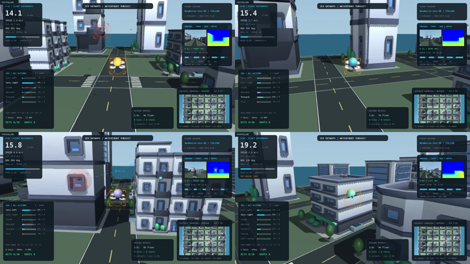

# Fleet demonstration captures

This GIF is an excerpt from a real eight-second MuJoCo capture from the public fleet package,
using seed 42, NeoHorse-Jev-4B text decisions and four physical pursuers.
The excerpt covers simulation seconds 1–5. This is a documentation capture,
kept outside the ranked production replay catalog; hit counts and physical
states were not altered to qualify them.

The source records 160 actual simulation frames at 20 FPS, with 0.05 s intervals,
including all active cameras and each camera's complete HUD. The GIF derivative
uses 900 px width, 8 FPS, a shared 96-color palette and a four-second loop to
keep README loading practical. The full overview recording is 2560×1440; each separate camera is 1280×720.

The scenario uses ideal target segmentation/odometry and ideal broadcast
communication. Rendering, endpoint errors and controller behavior remain
real. This brief demonstration is not a benchmark or a claim of superior
tracking success, collision-free flight or real-time throughput.

Static fallback:

